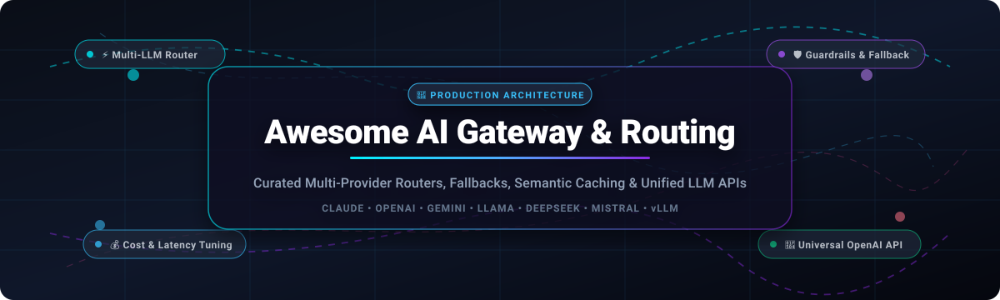
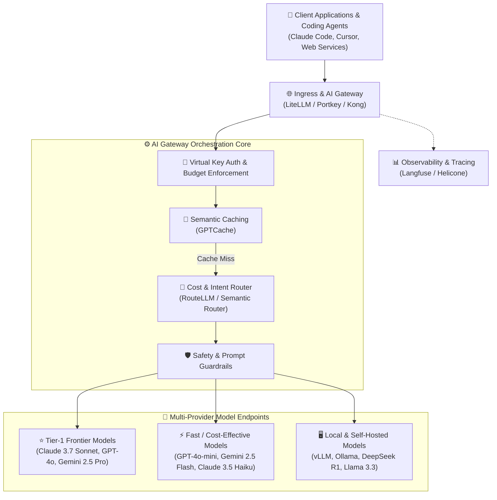

  

  
  
  
  
  

  <strong>Curated ecosystem of enterprise-grade AI Gateways, dynamic LLM Routers, and unified proxy infrastructure.</strong> 
  <em>Unify multi-provider access (OpenAI, Anthropic Claude, Google Gemini, DeepSeek, Meta Llama) with automated failover, intelligent cost routing, semantic caching, rate limiting, and observability.</em>

---

## 📑 Table of Contents

- [📈 Sector Overview & Market Dynamics](#-sector-overview--market-dynamics)
- [☁️ SaaS & Hosted AI Gateway Platforms](#️-saas--hosted-ai-gateway-platforms)
- [🐙 Open-Source GitHub Projects (Ranked by Stars)](#-open-source-github-projects-ranked-by-stars)
- [🏗️ Architectural Blueprint: Composing an AI Gateway Stack](#️-architectural-blueprint-composing-an-ai-gateway-stack)
- [🎯 Key Selection Criteria](#-key-selection-criteria)
- [⭐ Star History](#-star-history)
- [💖 Support & Community](#-support--community)
- [🤝 How to Contribute](#-how-to-contribute)
- [🔒 Disclaimer & Security Best Practices](#-disclaimer--security-best-practices)

---

## 📈 Sector Overview & Market Dynamics

The global **AI Gateway, LLM Routing, and Orchestration market** is currently estimated at **$2.5B to $4.2B**, expanding at a rapid compound annual growth rate (CAGR) of **~38%** as enterprise deployments transition from single-model experimentation to resilient multi-model production architectures. 

The sector is currently **moderately to highly fragmented** rather than concentrated or "winner-take-all":
- 🔄 **Standardized Abstraction Layer**: Because OpenAI-compatible REST schemas have become the universal protocol for inference, developer switching costs between gateways and routing layers remain exceptionally low.
- ⚡ **Divergent Architecture Demands**: Cloud platform incumbents (Cloudflare, Kong) compete on global edge latency and compliance, while developer-first open-source frameworks (LiteLLM, Portkey) lead developer mindshare for local VPC control, zero-markup pass-through, and auditability.
- 🧠 **Intelligent Routing Specialization**: A distinct niche of dynamic intent- and cost-based routers (Martian, RouteLLM) has emerged to arbitrate between frontier reasoning models and lightweight local/open weights on a per-token basis.

---

## ☁️ SaaS & Hosted AI Gateway Platforms

The following hosted and managed SaaS solutions provide turnkey AI gateways, automated failover, model routing, security guardrails, and usage observability.

*Products are sorted descending by company size, valuation, or annual revenue.*

| 🏷️ Product | 🏢 Company Size / Valuation / Revenue | 💵 Starting Tier Price | 🎁 Free Tier / Trial Limits | 🚀 Core Focus & Routing Features |
| :--- | :--- | :--- | :--- | :--- |
| **[Cloudflare AI Gateway](https://www.cloudflare.com/developer-platform/ai-gateway/)** | **~$35B Market Cap** *(NYSE: NET, ~$1.7B ARR)* | **$5/month** *(Workers Paid base)* | **Free forever**: • 100,000 logs/month • Up to 10 gateways • 10,000 Neurons/day compute on Workers AI | Edge-native gateway with zero-latency response caching, real-time analytics, rate limiting, and automatic multi-provider fallback. |
| **[Kong AI Gateway](https://konghq.com/products/kong-ai-gateway)** | **~$2.0B Valuation** *($345M+ raised, $100M+ ARR)* | **$250/month** *(Konnect Plus base plan)* | **30-Day Free Trial**: • Full access to managed Konnect SaaS platform • Up to 1M API requests during evaluation *(OSS self-hosted is free forever)* | Enterprise cloud API management extending native plugins to LLMs: semantic caching, prompt guardrails, and role-based credential routing. |
| **[Langfuse Cloud](https://langfuse.com/)** | **~$2.0B Valuation** *(Acquired by ClickHouse; ClickHouse valued at $2B+)* | **$29/month** *(Core tier; Pro tier at $199/month)* | **Free forever (Hobby)**: • 50,000 units/month (traces & observations) • 2 team seats • 30-day data retention | OpenLLMetry-based LLM observability platform with execution tracing, prompt evaluation, playground versioning, and gateway analytics. |
| **[Martian](https://withmartian.com/)** | **~$1.3B Valuation** *(Backed by NEA, Prosus, Accenture)* | **$20/month** *(Base usage minimum + provider pass-through)* | **14-Day Free Trial**: • $10 in complimentary routing credits across supported models | Proprietary Model Router that dynamically inspects prompt complexity and dispatches queries to the most cost-effective and accurate model. |
| **[Portkey](https://portkey.ai/)** | **~$110M Valuation** *($18M raised; acquired by Palo Alto Networks)* | **$49/month** *(Pro tier)* | **Free forever (Developer)**: • 10,000 recorded logs/month • 3 prompt templates • 3-day log retention | Multi-provider AI gateway connecting 1,600+ models with 45+ deterministic guardrails, conditional load balancing, and fallback logic. |
| **[OpenRouter](https://openrouter.ai/)** | **~$80M Valuation** *(Estimated $25M+ GMV run-rate)* | **$0/month base** *(Pay-as-you-go per token; 0% markup for BYOK)* | **Free forever**: • Access to 10+ free models (e.g., Llama 3 8B, Gemini 1.5 Flash 8B) • Capped at 20 req/min and 200 req/day | Aggregator and router providing unified access to 400+ models across 60+ providers with automated failover and cheapest-provider pricing. |
| **[LiteLLM Cloud](https://www.litellm.ai/)** | **~$25M Valuation** *(YC W23, $2.1M raised)* | **$250/month** *(Enterprise Basic tier)* | **14-Day Free Trial**: • Unlimited proxy requests & full enterprise control plane *(Self-hosted open source is free forever)* | Fully managed hosted LiteLLM proxy: unified OpenAI schema, virtual key generation, team-level budget limits, and upstream provider failover. |
| **[Helicone](https://www.helicone.ai/)** | **~$20M Valuation** *(YC W23, acquired by Mintlify)* | **$79/month** *(Pro tier; includes 7-day Pro trial)* | **Free forever (Hobby)**: • 10,000 requests/month • 1 seat & 1 GB storage • 7-day log retention | Proxy-first LLM observability: change your base URL for instant logging, cost tracking, semantic cache hit ratios, and prompt experiments. |
| **[Maxim AI](https://www.getmaxim.ai/)** | **~$15M Valuation** *(Pre-seed/Seed raised ~$2M)* | **$29/seat/month** *(Professional plan)* | **Free forever (Developer)**: • 10,000 logs & traces/month • Up to 3 seats | Evaluation, agent simulation, and real-time observability gateway designed for testing multi-turn agentic applications. |
| **[PromptLayer](https://promptlayer.com/)** | **~$12M Valuation** *(YC W23, raised ~$2M)* | **$49/month** *(Pro tier)* | **Free forever (Free tier)**: • 2,500 requests/month • 250 evaluation executions/month • 5 user seats | Specialized prompt management platform featuring visual prompt engineering, model regression testing, and gateway request tracing. |

---

## 🐙 Open-Source GitHub Projects (Ranked by Stars)

Self-hostable, transparent, and vendor-independent open-source AI gateways, reverse proxies, and intelligent routers.

*Repositories are sorted strictly in descending order of GitHub Stars_Count.*

1. **[OmniRoute](https://github.com/diegosouzapw/OmniRoute)**   
   ✨ **Free, multi-provider AI gateway providing unified access across 350+ providers and 1,200+ models.**  
   *📜 License: MIT*  
   Built specifically for coding agents (Claude Code, Cursor, Codex, OpenCode), OmniRoute features quota-aware automatic fallbacks, token compression pipelines (RTK + Caveman) saving 15–95% on context tokens, and model switching without manual reconfiguration.

2. **[LiteLLM](https://github.com/BerriAI/litellm)**   
   🔥 **The industry standard for multi-provider LLM gateway orchestration.**  
   *📜 License: MIT*  
   Translates 100+ LLM APIs (Bedrock, Azure, OpenAI, Anthropic, Vertex AI, vLLM, HuggingFace) into standard OpenAI-compatible format. Features virtual API keys with team-level rate limits and spend caps, fallback routing, dynamic load balancing, and native database logging.

3. **[Kong Gateway](https://github.com/Kong/kong)**   
   🦍 **Cloud-native API gateway with dedicated AI Gateway capabilities.**  
   *📜 License: Apache-2.0*  
   Extends Kong's battle-tested proxy infrastructure with AI-specific plugins: multi-LLM routing, semantic prompt caching, prompt injection guardrails, credential scrubbing, and rate-limiting across upstream model providers.

4. **[One API](https://github.com/songquanpeng/one-api)**   
   🌐 **All-in-one API hub and distribution system for Large Language Models.**  
   *📜 License: MIT*  
   Multi-channel, multi-tenant gateway that unifies standard OpenAI calls with Claude, Gemini, Ernie, Baichuan, and local endpoints. Features channel health checks, automatic channel failover, balance and quota allocation, and a built-in admin Web UI.

5. **[Langfuse](https://github.com/langfuse/langfuse)**   
   🪢 **Open-source LLM engineering and observability platform.**  
   *📜 License: MIT Core*  
   Provides detailed distributed tracing for complex multi-step LLM chains and agent workflows, alongside dataset management, automated evaluations, prompt playgrounds, and fine-grained latency and token cost analytics.

6. **[Apache APISIX](https://github.com/apache/apisix)**   
   ⚡ **Dynamic, high-performance API gateway with AI proxy plugins.**  
   *📜 License: Apache-2.0*  
   Built on NGINX and OpenResty, APISIX provides native AI proxy plugins for LLM load balancing, token rate limiting, fallback routing, and integration with OpenAI, DeepSeek, and Anthropic APIs.

7. **[Portkey Gateway](https://github.com/Portkey-AI/gateway)**   
   🚀 **High-throughput AI gateway with integrated guardrails.**  
   *📜 License: Apache-2.0*  
   Ultra-fast, enterprise-ready gateway routing to 1,600+ models. Supports advanced routing strategies (fallback, load balance, canary deployments, conditional routing), semantic caching, retries, and comprehensive compliance logging.

8. **[TensorZero](https://github.com/tensorzero/tensorzero)**   
   🦀 **High-performance LLMOps gateway, observability, and optimization engine.**  
   *📜 License: Apache-2.0*  
   Written in Rust, TensorZero serves as an enterprise gateway unifying LLM model invocation, metric collection, dynamic experimentation (A/B testing and bandit routing), and fine-tuning pipelines.

9. **[Tyk API & AI Gateway](https://github.com/TykTechnologies/tyk)**   
   🛡️ **Open-source API gateway supporting REST, GraphQL, gRPC, and MCP.**  
   *📜 License: MPL-2.0*  
   Enterprise gateway providing native AI mediation, Model Context Protocol (MCP) support, security policies, token-based rate limiting, and multi-model traffic management.

10. **[Higress](https://github.com/higress-group/higress)**   
    🤖 **Next-generation cloud-native AI gateway built on Envoy and Istio.**  
    *📜 License: Apache-2.0*  
    Initiated by Alibaba, Higress acts as an AI-native gateway combining API gateway, ingress controller, and AI proxy functionality. Provides multi-model failover, token-level flow control, and WebAssembly plugin extensibility.

11. **[Bifrost (Maxim AI)](https://github.com/maximhq/bifrost)**   
    ⚡ **Sub-millisecond enterprise LLM, MCP, and agent gateway in Go.**  
    *📜 License: Apache-2.0*  
    Adds under 200µs of overhead at 5k RPS. Acts as a unified drop-in OpenAI-compatible proxy with support for 10,000+ models, MCP Code Mode, semantic caching, virtual budgets, and circuit-breaker failover.

12. **[GPTCache](https://github.com/zilliztech/GPTCache)**   
    💾 **Semantic caching layer for Large Language Model queries.**  
    *📜 License: MIT*  
    Constructs semantic embedding similarity caches for LLM responses. Drastically reduces API latency and token expenditures by returning cached responses for semantically equivalent prompts.

13. **[LLM Gateway (Manifest)](https://github.com/mnfst/llm-gateway)**   
    🦚 **Self-hosted, developer-friendly proxy for multi-provider routing.**  
    *📜 License: Apache-2.0*  
    Provides single-endpoint access to multiple LLM backends with rate limiting, unified key management, and configurable fallback chains.

14. **[gpt-load](https://github.com/tbphp/gpt-load)**   
    ⚖️ **Self-hosted AI gateway for multi-channel & multi-credential scheduling.**  
    *📜 License: GPL-3.0*  
    Designed for unified credential management across API keys and subscription accounts. Features multi-account rotation, scheduling fault tolerance, request logging, and aggregated usage metrics.

15. **[Helicone OSS](https://github.com/Helicone/helicone)**   
    🔍 **Open-source observability and proxy engine for LLM developers.**  
    *📜 License: Apache-2.0*  
    Self-hostable edition of Helicone: real-time request proxying, token usage tracking, custom metadata labeling, prompt version management, and query analysis.

16. **[kgateway](https://github.com/kgateway-dev/kgateway)**   
    ☸️ **Envoy-powered cloud-native API and AI gateway for Kubernetes.**  
    *📜 License: Apache-2.0*  
    Kubernetes Gateway API-compliant gateway designed for multi-model LLM routing, token-bucket rate limiting, and secure egress to frontier model APIs.

17. **[RouteLLM](https://github.com/lm-sys/RouteLLM)**   
    🎯 **Evaluation and serving framework for cost-optimized LLM routing.**  
    *📜 License: Apache-2.0*  
    Trained on human preference datasets from LMSYS, RouteLLM dynamically classifies input complexity and dispatches prompts to cheaper models (e.g., Llama 3 8B) when possible, only falling back to frontier models (e.g., GPT-4o) when strictly necessary—slashing inference costs by up to 85%.

18. **[AxonHub](https://github.com/looplj/axonhub)**   
    🧩 **Open-source AI Gateway with multi-provider routing and cost control.**  
    *📜 License: MIT*  
    Connects to 100+ LLMs with unified OpenAI SDK compatibility. Features automatic retries, provider failover, load balancing, token quotas, and end-to-end tracing.

19. **[Semantic Router](https://github.com/aurelio-labs/semantic-router)**   
    🧠 **Superfast semantic decision layer for LLMs and agentic routing.**  
    *📜 License: Apache-2.0*  
    Uses local vector embeddings rather than slow LLM classifier calls to route prompts to specialized handlers, distinct models, or guardrails within milliseconds.

---

## 🏗️ Architectural Blueprint: Composing an AI Gateway Stack

For engineering teams constructing a resilient, production-ready, vendor-agnostic infrastructure, a layered approach is recommended:

---

## 🎯 Key Selection Criteria

When choosing an AI Gateway solution, evaluate your stack across these five pillars:

1. 🔌 **Protocol Compatibility**: Does the gateway expose an identical OpenAI-compatible `/v1/chat/completions`, `/v1/embeddings`, and `/v1/responses` format so your application requires zero code refactoring?
2. 🔄 **Failover & Load Balancing**: Can the router automatically retry transient 429 (Rate Limit) and 5xx errors by seamlessly shifting traffic across backup providers or alternate regions?
3. 💰 **Budget & Virtual Key Management**: Does the gateway let you issue scoped API keys with hard token or dollar limits per developer, team, or application?
4. ⚡ **Semantic Caching**: Can the system prevent redundant upstream calls for repeated or semantically similar prompts to save costs and reduce latency?
5. 🔒 **Data Privacy & Compliance**: Does your workload demand SOC 2 Type II, HIPAA, or on-premise VPC hosting where prompts and API keys never exit your private perimeter?

---

## ⭐ Star History

---

## 💖 Support & Community

Thank you for visiting and supporting the **Awesome AI Gateway & Routing** ecosystem! 🚀

If you found this curated directory helpful for your architecture, evaluation, or production deployment:
- ⭐ **Star this repository** on GitHub to help other engineers discover it.
- 🍴 **Fork and contribute** by adding new tools, benchmarks, or documentation updates.
- 📢 **Share with your team**, peer developers, and LLMOps communities on X / Twitter, LinkedIn, and Discord.
- ☕ **Support continuous maintenance & updates**: If this list saved you engineering hours, consider sponsoring or buying a coffee via the [GitHub Sponsor Dashboard](https://github.com/sponsors/ishandutta2007).

  

---

## 🤝 How to Contribute

Contributions are warmly welcome! To add or update an entry:

1. 🍴 Fork the repository.
2. 📝 Ensure new SaaS entries follow the structured table format (including exact pricing and verified free tier limits).
3. 🏷️ Ensure new Open-Source projects include an accurate Stars_Badge formatted as:  
   ``
4. 🔢 Keep entries sorted according to their specified sorting criteria (Company Size descending for SaaS; Stars_Count descending for Open Source).
5. 🚀 Submit a pull request with a brief explanation.

---

## 🔒 Disclaimer & Security Best Practices

- 📌 This list is community-curated for informational purposes and does not constitute formal endorsement.
- 🔑 **API Key Security**: Never embed upstream provider keys directly inside frontend applications. Always route requests through a protected gateway with scoped virtual tokens.
- 🌐 **Compliance & Privacy**: Ensure routing rules respect geographical and regulatory constraints (e.g., GDPR, HIPAA, EU data sovereignty) when failing over between US and European endpoints.

---

🏷️ **Keywords for Discovery**: AI Gateway, LLM Gateway, LLM Routing, Model Router, OpenAI Proxy, Multi-Provider Fallback, Semantic Caching, LiteLLM, Portkey, Langfuse, RouteLLM, Helicone, Cloudflare AI Gateway, Kong AI Gateway, Generative AI Infrastructure, LLMOps.
